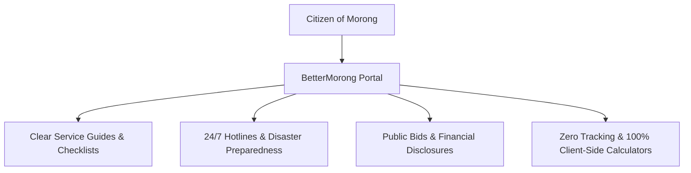

# BetterMorong Brand & Civic Identity Guide

> **Version:** 1.5.0  
> **Audience:** Civic Tech Volunteers, Designers, Content Authors, Municipal Partners  
> **Repository:** [BetterMorong (GitHub)](https://github.com/betterlocalgov/bettermorong)  
> **Status:** Active Standard

---

## 1. Executive Summary & Brand Purpose

**BetterMorong** is an open-source, volunteer-driven civic technology portal built for the residents, businesses, and visitors of the **Municipality of Morong, Province of Rizal, Philippines**.

Our mission is to provide **uncluttered, direct, and barrier-free access** to municipal public services, citizen's charters, statutory fees, emergency hotlines, and local ordinances—completely independent of changing political administrations.



---

## 2. Core Pillars & Ethos

### Pillar 1: The Anti-Epal Doctrine (Strict Institutional Attribution)

Public services and infrastructure are funded by taxpayer money and executed by civil servants and institutions—not by individual elected officials.

- **Rule:** Never display the names, faces, signatures, initials, political party colors, campaign taglines, or portraits of active, re-election, or former politicians anywhere in the interface or documentation.
- **Attribution Standard:** Always credit the municipal office or institution (e.g., _"Morong Municipal Civil Registry"_, _"Morong Municipal Health Office (MHO)"_, _"Bids and Awards Committee (BAC) Secretariat"_).

### Pillar 2: Offline-First Resilience (Typhoon Mode)

Morong's geography—bordered by the Morong River, Laguna de Bay, and Sierra Madre mountain foothills—exposes residents to seasonal habagat flooding, typhoons, and telecom power blackouts.

- BetterMorong operates as an offline-first **Progressive Web App (PWA)**.
- Once visited, app shells, 24/7 hotlines, evacuation routes, and disaster preparedness manuals remain 100% accessible without cellular reception or Wi-Fi.

### Pillar 3: Radical Civic Transparency

Democracy thrives when public records are freely accessible without cumbersome bureaucratic roadblocks.

- Full indexed access to the Local Government Unit's **BAC Procurement Monitoring Reports (PMR)**, **Notices of Award (NOA)**, **Notices to Proceed (NTP)**, and **BLGF Financial Statements**.
- Built-in search, barangay tagging, and direct links to public PDF uploads.

### Pillar 4: Zero-Knowledge Citizen Privacy

- No third-party ad tracking, user surveillance, or mandatory account creation for basic public information.
- Sensitive tools (e.g., **Cedula Income Estimator** and **Amilyar Property Tax Estimator**) execute **100% client-side** inside the citizen's browser. No financial data is ever collected or sent to any server.

---

## 3. Brand Assets & Visual Identity

All official brand assets reside in the [`public/`](file:///c:/Users/kaths/OneDrive/Desktop/Development/bettermorong/public/) directory:

| Asset Name                   | File Path                                                                                                                     | Usage & Description                                                                                            |
| :--------------------------- | :---------------------------------------------------------------------------------------------------------------------------- | :------------------------------------------------------------------------------------------------------------- |
| **Municipal Seal**           | [`public/Morong-Logo.svg`](file:///c:/Users/kaths/OneDrive/Desktop/Development/bettermorong/public/Morong-Logo.svg)           | Official municipal emblem of Morong, Rizal featuring the historic church, gear of industry, and laurel leaves. |
| **Clean Seal (Transparent)** | [`public/morong-logo-nobg.svg`](file:///c:/Users/kaths/OneDrive/Desktop/Development/bettermorong/public/morong-logo-nobg.svg) | High-resolution SVG seal without solid white backing for dark/colored overlays.                                |
| **Favicon**                  | [`public/favicon.svg`](file:///c:/Users/kaths/OneDrive/Desktop/Development/bettermorong/public/favicon.svg)                   | Clean vector favicon optimized for browser tabs and pinned bookmarks.                                          |
| **Church Silhouette**        | [`public/morong-simbahan.svg`](file:///c:/Users/kaths/OneDrive/Desktop/Development/bettermorong/public/morong-simbahan.svg)   | Stylized architectural vector of the Saint Jerome Parish Church belfry (built 1615).                           |
| **App Icon / PFP**           | [`public/morong-pfp.png`](file:///c:/Users/kaths/OneDrive/Desktop/Development/bettermorong/public/morong-pfp.png)             | 44KB raster PNG icon for PWA web app manifest and Apple Touch Icons.                                           |
| **Social Share Banner**      | [`public/og-image.png`](file:///c:/Users/kaths/OneDrive/Desktop/Development/bettermorong/public/og-image.png)                 | Standard 1200×630 Open Graph card preview for social networks and messaging apps.                              |

---

## 4. Typography System

BetterMorong incorporates the **Kapwa Design System** typography primitives alongside Google Web Fonts:

- **Primary UI Sans-Serif:** `Inter`, ui-sans-serif, system-ui, -apple-system, sans-serif
  - Configured as `--font-kapwa-sans` in [`src/fonts.css`](file:///c:/Users/kaths/OneDrive/Desktop/Development/bettermorong/src/fonts.css).
  - Clean, highly legible at small sizes on mobile devices and budget displays.
- **Monospace (Data & Rates):** `Roboto Mono`, ui-monospace, monospace
  - Configured as `--font-kapwa-mono`.
  - Used for statutory Republic Act citations, currency calculations (`₱`), phone numbers, and ASCII print checkboxes.
- **Editorial Serif (Heritage & Legal):** `Georgia`, `Times New Roman`, serif
  - Configured as `--font-serif` in Tailwind `@theme`.
  - Used optionally in historical documents and legislative resolutions.

---

## 5. Voice, Tone & Editorial Style

### Bilingual Inclusivity

Every core service guide, emergency alert, and interactive component supports both **English** (`en`) and **Filipino** (`fil`) via [`src/locales/`](file:///c:/Users/kaths/OneDrive/Desktop/Development/bettermorong/src/locales/).

### Tone Characteristics

1. **Objective & Factual:** Informative, calm, and reassuring. Avoid hyperbolic civic marketing or flowery political praise.
2. **Action-Oriented:** Start requirement lists and procedural steps with direct action verbs:
   - _Filipino:_ _"Ihanda ang mga dokumento"_, _"Magtungo sa Munisipyo"_, _"Bayaran ang kaukulang buwis"_.
   - _English:_ _"Prepare supporting evidence"_, _"Proceed to Treasury Office"_, _"Claim your permit card"_.
3. **Respectful of Vulnerable Groups:** Delineate distinct statutory benefits and express priority lanes for Senior Citizens, Persons with Disabilities (PWDs), Solo Parents, and 4Ps beneficiaries under national legislation (RA 9994, RA 10754, RA 8972).

---

## 6. Prohibited Practices & Compliance

```
[❌ PROHIBITED]
- "Serbisyo handog ni Mayor [Name]"
- "Proyektong pinondohan sa inisyatiba ni Congressman [Name]"
- Adding campaign color banners during election seasons
- Hiding statutory fees or pretending municipal permits are free when ordinances specify otherwise

[✅ REQUIRED]
- "Serbisyo ng Pamahalaang Bayan ng Morong, Rizal"
- "Opisyal na Pabatid mula sa Morong Municipal Health Office"
- Clear statutory basis (e.g., "Ayon sa Republic Act No. 7160...")
- Transparent itemization of official regulatory fees and prompt payment discounts
```
