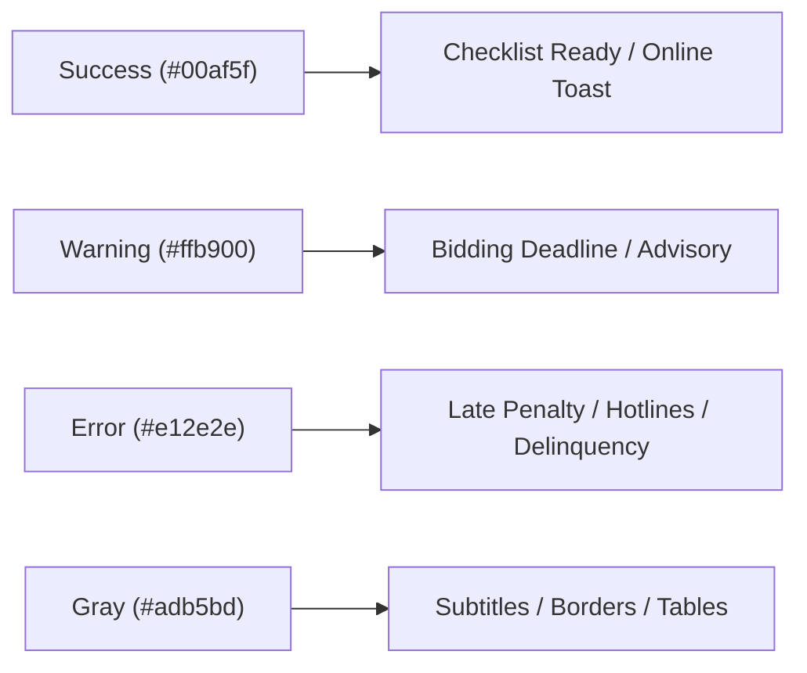

# BetterMorong Color Palette & Design Tokens

> **Version:** 1.5.0  
> **Source of Truth:** [`src/index.css`](file:///c:/Users/kaths/OneDrive/Desktop/Development/bettermorong/src/index.css)  
> **Specification:** Tailwind CSS v4 `@theme` & Kapwa Design System

---

## 1. Overview & Color Philosophy

The BetterMorong color architecture reflects the geographic and cultural identity of the **Municipality of Morong, Rizal**:

- **Civic Blue (`primary`):** Symbolic of Laguna de Bay lakeshore barangays, the Morong River, and steadfast civic governance.
- **Heritage Terracotta (`secondary`):** Derived from the colonial adobe, clay, and Spanish brick masonry of the historic Saint Jerome Parish Church.
- **Civic Gold & Amber (`accent`):** High-visibility alerts and notification states representing solar energy, alertness, and civil defense.
- **Semantic Indicators:** Purpose-built, WCAG-compliant status tokens for interactive checklists, tax estimations, and emergency banners.

---

## 2. Core Color Tokens

### Primary — Civic Blue

The core brand color used for navigation headers, primary action buttons, links, and focused input rings.

| Token             | CSS Variable              | Hex Code      | Preview | Recommended Usage                              |
| :---------------- | :------------------------ | :------------ | :-----: | :--------------------------------------------- |
| `primary-50`      | `--color-primary-50`      | `#e6f0fd`     |   `■`   | Subtle card highlights, hover backgrounds      |
| `primary-100`     | `--color-primary-100`     | `#cce0fb`     |   `■`   | Progress bar background, badge fill            |
| `primary-200`     | `--color-primary-200`     | `#99c2f7`     |   `■`   | Card borders, subtle focus outlines            |
| `primary-300`     | `--color-primary-300`     | `#66a3f3`     |   `■`   | Decorative vector fills, secondary borders     |
| `primary-400`     | `--color-primary-400`     | `#3385ef`     |   `■`   | Interactive hover states                       |
| **`primary-500`** | **`--color-primary-500`** | **`#0066eb`** |   `■`   | **Brand primary default, checked task items**  |
| `primary-600`     | `--color-primary-600`     | `#0052bc`     |   `■`   | Active buttons, focused states, primary links  |
| `primary-700`     | `--color-primary-700`     | `#003d8d`     |   `■`   | Deep banner gradients, high-contrast headings  |
| `primary-800`     | `--color-primary-800`     | `#00295e`     |   `■`   | Dark header backgrounds (`#1E40AF` equivalent) |
| `primary-900`     | `--color-primary-900`     | `#00142f`     |   `■`   | Deep typography, dark mode container text      |

```css
/* Example usage in CSS / Tailwind */
.btn-primary {
  background-color: var(--color-primary-600);
  color: #ffffff;
}
```

---

### Secondary — Heritage Terracotta

Used for civic tech badges, cultural highlights, and secondary callouts.

| Token               | CSS Variable                | Hex Code      | Preview | Recommended Usage            |
| :------------------ | :-------------------------- | :------------ | :-----: | :--------------------------- |
| `secondary-50`      | `--color-secondary-50`      | `#ffede6`     |   `■`   | Soft background tints        |
| `secondary-100`     | `--color-secondary-100`     | `#ffdbcc`     |   `■`   | Light badge fills            |
| `secondary-200`     | `--color-secondary-200`     | `#ffb799`     |   `■`   | Soft borders                 |
| `secondary-300`     | `--color-secondary-300`     | `#ff9466`     |   `■`   | Decorative accents           |
| `secondary-400`     | `--color-secondary-400`     | `#ff7033`     |   `■`   | Subtle warnings              |
| **`secondary-500`** | **`--color-secondary-500`** | **`#ff4d00`** |   `■`   | **Heritage terracotta base** |
| `secondary-600`     | `--color-secondary-600`     | `#cc3e00`     |   `■`   | Interactive hover states     |
| `secondary-700`     | `--color-secondary-700`     | `#992e00`     |   `■`   | Deep accent typography       |
| `secondary-800`     | `--color-secondary-800`     | `#661f00`     |   `■`   | Dark container borders       |
| `secondary-900`     | `--color-secondary-900`     | `#330f00`     |   `■`   | Deepest contrast backgrounds |

---

### Accent — Civic Amber

Used for notice blocks, announcements, and offline banner indicators.

| Token            | CSS Variable             | Hex Code      | Preview | Recommended Usage                           |
| :--------------- | :----------------------- | :------------ | :-----: | :------------------------------------------ |
| `accent-50`      | `--color-accent-50`      | `#fef3e6`     |   `■`   | Advisory box backgrounds                    |
| `accent-100`     | `--color-accent-100`     | `#fde7cc`     |   `■`   | Advisory border accents                     |
| `accent-200`     | `--color-accent-200`     | `#fbd099`     |   `■`   | Notice cards                                |
| `accent-300`     | `--color-accent-300`     | `#f9b866`     |   `■`   | Warning icons                               |
| `accent-400`     | `--color-accent-400`     | `#f7a133`     |   `■`   | Highlight borders                           |
| **`accent-500`** | **`--color-accent-500`** | **`#f58900`** |   `■`   | **Accent base, offline notification badge** |
| `accent-600`     | `--color-accent-600`     | `#c46e00`     |   `■`   | Typhoon banner (`bg-amber-600`)             |
| `accent-700`     | `--color-accent-700`     | `#935200`     |   `■`   | High-contrast warning headings              |
| `accent-800`     | `--color-accent-800`     | `#623700`     |   `■`   | Warning text on light backgrounds           |
| `accent-900`     | `--color-accent-900`     | `#311b00`     |   `■`   | Deep amber border                           |

---

## 3. Semantic & Status Colors

These functional tokens communicate state, confirmation, caution, and danger.



### Success (Laguna Emerald)

- `success-50`: `#e6f7ef` (Badge background)
- `success-100`: `#ccefdf` (Checklist 100% completion pill)
- `success-500`: **`#00af5f`** (Success icon, completed checkmarks)
- `success-600`: `#008c4c` (Progress bar full fill)
- `success-700`: `#006939` (Online reconnection banner)

### Warning (Sun Gold)

- `warning-50`: `#fff8e6` (Notice box)
- `warning-500`: **`#ffb900`** (Advisory star / pending icon)
- `warning-700`: `#996f00` (Advisory text)

### Error / Danger (Emergency Red)

- `error-50`: `#fceaea` (Late fee background highlight)
- `error-500`: **`#e12e2e`** (Late fee indicator, emergency dispatch)
- `error-600`: `#b42525` (Active error button, reset hover)
- `error-700`: `#871c1c` (Statutory penalty text)

### Neutral Gray (Slate & Charcoal)

- `gray-50`: `#f8f9fa` (Page background, alternating table rows)
- `gray-100`: `#f1f3f5` (Button secondary background, code blocks)
- `gray-200`: `#e9ecef` (Card borders, dividers)
- `gray-300`: `#dee2e6` (Input borders)
- `gray-500`: `#adb5bd` (Placeholder text)
- `gray-700`: `#495057` (Standard body text)
- `gray-800`: `#343a40` (Subheadings)
- `gray-900`: `#212529` (Primary typography)

---

## 4. Accessibility & Contrast Standards

BetterMorong enforces **WCAG 2.1 Level AA** compliance across all UI components:

1. **Normal Text (under 18pt / 24px):** Minimum contrast ratio of **4.5:1** against adjacent backgrounds.
2. **Large Text & Headings (18pt+ or bold 14pt+):** Minimum contrast ratio of **3.0:1**.
3. **Interactive UI Components & Focus Rings:** Minimum **3.0:1** contrast against surrounding backgrounds.
4. **Color Independence:** No UI state is conveyed solely by color. Every status indicator combines color with text or iconography (e.g. checkmark icon `CheckCircle2` accompanies emerald green text).

---

## 5. Print Mode Suppression (`@media print`)

To protect citizen printer ink and ensure maximum legibility when guides are printed at home or at local computer shops (_pisonet_ / photocopy centers):

```css
@media print {
  /* Force pure black-on-white high contrast */
  html,
  body {
    background-color: #ffffff !important;
    color: #111827 !important;
  }

  /* Strip heavy background gradients and shadows */
  article,
  .card,
  table {
    box-shadow: none !important;
    border-color: #d1d5db !important;
  }

  /* Hide ink-draining solid backgrounds */
  nav,
  footer,
  aside,
  button,
  .weather-widget {
    display: none !important;
  }
}
```
