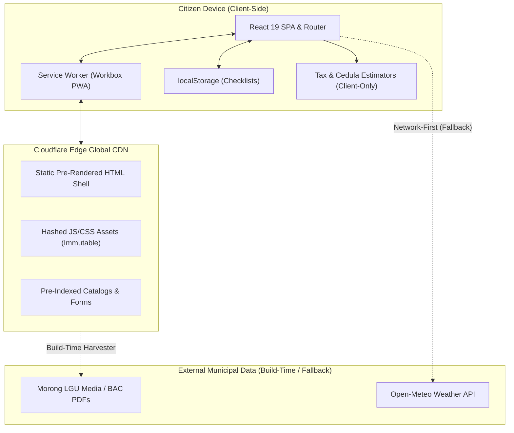
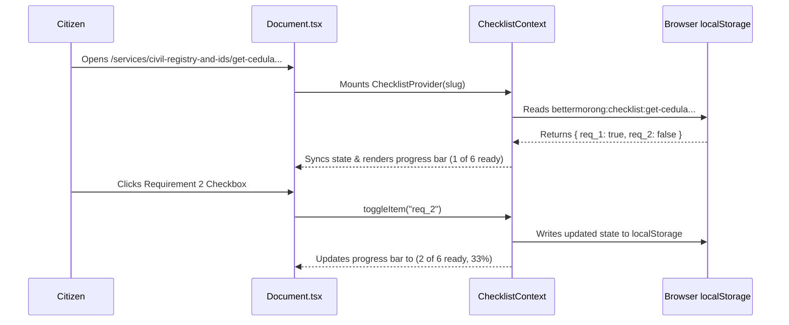
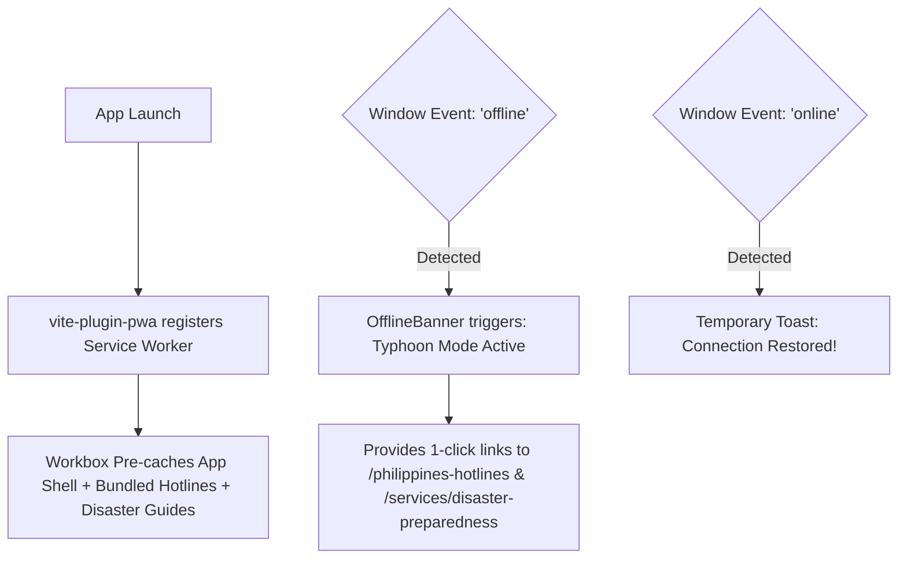

# BetterMorong System Architecture & Technical Design

> **Version:** 1.5.0  
> **Audience:** Core Engineers, Contributors, System Architects  
> **Platform:** Cloudflare Pages (Edge Jamstack) + Offline PWA

---

## 1. System Overview

**BetterMorong** is engineered as an offline-first, client-side enriched Jamstack web application designed for high availability, zero server-side maintenance costs, and maximum accessibility during power outages and natural calamities.



---

## 2. Technology Stack

| Layer                   | Technologies                                   | Justification & Role                                                 |
| :---------------------- | :--------------------------------------------- | :------------------------------------------------------------------- |
| **Framework & Core**    | React 19, TypeScript 5, Vite 8                 | Ultra-fast HMR, strict type safety, modern concurrent rendering      |
| **Routing & URL State** | React Router 7/8, `nuqs`                       | Client-side routing with URL query string synchronization            |
| **Design System**       | `@bettergov/kapwa`, Tailwind CSS v4            | GovPH-inspired accessible UI components, `@theme` color tokens       |
| **Content Pipeline**    | Markdown (GFM), YAML (`js-yaml`), `rehype-raw` | Human-editable civic guides, structured frontmatter hooks            |
| **Offline & PWA**       | `vite-plugin-pwa`, Workbox v7                  | Offline caching, standalone web manifest, auto-updating SW           |
| **Icons & Visuals**     | `lucide-react`                                 | Clean, accessible SVG iconography                                    |
| **Localization**        | `i18next`, `react-i18next`                     | Zero-overhead runtime language switching (`en` <-> `fil`)            |
| **Hosting & Edge**      | Cloudflare Pages, Wrangler                     | Global low-latency CDN, zero server vulnerabilities, DDoS resilience |

---

## 3. Architecture Layers & Directory Structure

```
bettermorong/
├── content/                     # Markdown source of truth
│   ├── government/              # Departments, Transparency, About Morong
│   └── services/                # 9 Service categories (Civil Registry, Health, etc.)
├── public/                      # Static assets, seals, PWA manifest, forms
│   ├── _headers                 # Cloudflare cache headers & security policies
│   ├── forms/                   # Downloadable official municipal PDF templates
│   └── favicon.svg, Morong-Logo.svg
├── scripts/                     # Build-time synchronization & indexing tools
│   ├── fetch-morong-bac.mjs     # WordPress REST API document harvester
│   └── index-content.mjs        # Static search index generator
├── src/
│   ├── components/
│   │   ├── government/          # BAC Explorer, Forms Hub, Budget Dashboard
│   │   ├── layout/              # Navbar, Footer, OfflineBanner
│   │   ├── services/            # Tax & Cedula Fee Estimator
│   │   └── ui/                  # ServiceGuideToolbar, DownloadableFormsCard
│   ├── context/                 # ChecklistContext (client persistence)
│   ├── data/                    # services.yaml, hotlinesData.ts, lgu documents
│   ├── hooks/                   # useMorongWeather, useTranslation
│   ├── lib/                     # markdownLoader, markdownComponents, searchIndex
│   ├── locales/                 # en/common.json, fil/common.json
│   ├── pages/                   # Document.tsx, Services.tsx, Government.tsx, etc.
│   └── App.tsx, main.tsx        # Application shell & root provider
```

---

## 4. Subsystems & Key Data Flows

### A. Interactive Requirement Checklists (`ChecklistContext`)

Allows citizens to track preparation of documentary requirements across any service guide.



- **Persistence Key:** `bettermorong:checklist:${slug}`
- **Auto-Transformation:** Markdown lists under requirement headings (`Requirement`, `What to Bring`, `Checklist`, `Kinakailangan`, `Dalhin`) are converted to interactive accessible checkboxes on the fly.

---

### B. Offline Typhoon Mode Engine (PWA & `OfflineBanner`)

During typhoons or flooding, cellular towers in Rizal frequently lose power or experience extreme congestion.



- **Manifest:** Standalone PWA display, portrait orientation, theme color `#1E40AF`.
- **Pre-Cache Strategy:** App shell, JS/CSS, all 24/7 hotline numbers, national emergency contacts, and disaster preparation manuals are pre-cached upon initial load.
- **Dynamic Weather Strategy:** Open-Meteo weather requests use `NetworkFirst` with a 15-minute expiration and a static fallback object, guaranteeing that a weather service timeout never degrades the rest of the application.

---

### C. Client-Side Financial Fee & Tax Estimator (`TaxAndCedulaEstimator`)

Provides instant, 100% private calculations without sending financial numbers across the internet.

1. **Cedula Calculator (Republic Act No. 7160 Sec. 157 & 161):**
   $$\text{Basic Tax} = 5.00\text{ PHP}$$
   $$\text{Income Additional} = \min\left(5000, \left\lfloor\frac{\text{Gross Annual Income}}{1000}\right\rfloor \times 1.00\right)$$
   $$\text{Property Additional} = \min\left(5000, \left\lfloor\frac{\text{Assessed Property Value}}{1000}\right\rfloor \times 1.00\right)$$
   $$\text{Subtotal} = \text{Basic} + \text{Income Additional} + \text{Property Additional}$$
   $$\text{Late Penalty} = \begin{cases} \text{Subtotal} \times (0.02 \times \text{Delinquent Months}), & \text{if after Feb 28} \\ 0, & \text{otherwise} \end{cases}$$

2. **Real Property Tax (Amilyar) Calculator (RA 7160 Sec. 233 & 235):**
   $$\text{Basic RPT} = \text{Assessed Value} \times 0.01$$
   $$\text{SEF} = \text{Assessed Value} \times 0.01$$
   $$\text{Gross Total} = \text{Basic RPT} + \text{SEF} = \text{Assessed Value} \times 0.02$$
   $$\text{Prompt Discount} = \text{Gross Total} \times 0.10 \quad (\text{if early payment toggled})$$
   $$\text{Net Annual Due} = \text{Gross Total} - \text{Prompt Discount}$$
   $$\text{Quarterly Installment} = \frac{\text{Net Annual Due}}{4}$$

---

### D. Public Documents & Transparency Repository (`LguDocumentsExplorer`)

- Indexes 110+ official public municipal procurement records, Invitations to Bid, Notices of Award (NOA), Notices to Proceed (NTP), and Citizen's Charters.
- Harvester script [`scripts/fetch-morong-bac.mjs`](file:///c:/Users/kaths/OneDrive/Desktop/Development/bettermorong/scripts/fetch-morong-bac.mjs) synchronizes the static catalog directly with `morongrizal.gov.ph` WordPress Media APIs at build time.
- 100% client-side multi-filter queries across keyword, category, year (2018–2026), and barangay.

---

## 5. Security & Edge Configuration

Cloudflare Pages applies strict HTTP response headers configured via [`public/_headers`](file:///c:/Users/kaths/OneDrive/Desktop/Development/bettermorong/public/_headers):

```http
/*
  X-Frame-Options: SAMEORIGIN
  X-Content-Type-Options: nosniff
  Referrer-Policy: strict-origin-when-cross-origin
  Permissions-Policy: camera=(), microphone=(), geolocation=()

/assets/*
  Cache-Control: public, max-age=31536000, immutable

/*.html
  Cache-Control: public, max-age=0, must-revalidate

/sw.js
  Cache-Control: public, max-age=0, must-revalidate

/manifest.webmanifest
  Cache-Control: public, max-age=0, must-revalidate
```

- **Zero Attack Surface:** Static Jamstack deployment has no running application server, no relational SQL database, and no server-side secrets exposed to the web.
- **Service Worker Lifecycle:** `/sw.js` and `/manifest.webmanifest` are served with `max-age=0, must-revalidate` so updates are downloaded by citizens immediately without getting stuck in stale browser caches.
